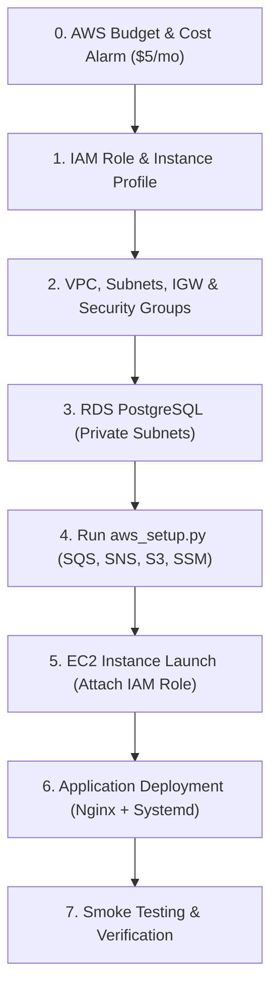

# UptimeWatch — AWS Integration Readiness Audit Report (Phase 3 Pre-Deployment)

**Project:** UptimeWatch — Cloud-Native Website Availability Monitoring & Alerting Platform  
**Audit Date:** October 26, 2026  
**Auditor:** Principal Cloud Solutions Architect & DevOps Specialist (Antigravity)  
**Deployment Target:** Amazon Web Services (AWS) — Free Tier Eligible Topology  
**Current State:** Local Phase 2 Verified (FastAPI + SQLite + Worker + React 19 Frontend)  
**AWS Resource Status:** **0 Live AWS Resources Created / 100% Offline Local Simulation**

---

## 1. Executive Summary

UptimeWatch has reached a stable, fully functional local milestone. The application architecture—comprising a FastAPI REST backend, an asynchronous/concurrent synthetic HTTP monitoring engine, an SQLite persistent database, and a responsive React 19 + Vite dashboard—has passed all 13 automated backend tests and builds into a production-optimized bundle with zero warnings.

This readiness audit evaluated the codebase against real AWS deployment requirements across 11 core infrastructure dimensions. The codebase demonstrates **high architectural maturity**:
- Database models and connection layers are designed for zero-code-change migration from local SQLite to Amazon RDS PostgreSQL.
- The `aws_client.py` singleton provides strict environment isolation, fail-fast protection in production, and zero log exposure of secrets.
- An idempotent infrastructure provisioner (`aws_setup.py`) and least-privilege IAM policy document (`aws/iam_policies.json`) are pre-constructed.
- Zero AWS resources currently exist; all cloud telemetry, S3 archival, and SNS dispatches currently operate in safe local simulation mode.

Before provisioning live AWS resources, critical bridging steps must be addressed: updating expired local credentials, implementing an SQS consumer worker loop for distributed checks, and wiring backend incident state transitions to live SNS dispatches.

---

## 2. Services Already Implemented (Code Ready)

The following services have complete or near-complete code logic ready to connect to AWS:

| Service | Implemented Components | File References |
| :--- | :--- | :--- |
| **AWS Authentication & Client Factory** | Thread-safe singleton client factory (`AWSClientManager`), automated STS caller identity verification, runtime mode switching (`APP_ENV` vs `SIMULATION_MODE`), credential masking utility (`sanitize_value`). | [`aws_client.py:L61-180`](file:///c:/Users/ARNAV%20BRAHMANE/OneDrive/Desktop/CCL/MINIPROJECT/aws_client.py) |
| **Database Abstraction (RDS Ready)** | SQLAlchemy 2.0 ORM schemas for `monitors`, `monitoring_checks`, and `incidents` with cascading foreign keys and composite indexes; dynamic database URL resolution supporting `postgresql://` and `sqlite:///`. `psycopg2-binary` driver included. | [`backend/database.py`](file:///c:/Users/ARNAV%20BRAHMANE/OneDrive/Desktop/CCL/MINIPROJECT/backend/database.py), [`backend/models.py`](file:///c:/Users/ARNAV%20BRAHMANE/OneDrive/Desktop/CCL/MINIPROJECT/backend/models.py), [`requirements.txt`](file:///c:/Users/ARNAV%20BRAHMANE/OneDrive/Desktop/CCL/MINIPROJECT/requirements.txt) |
| **SQS Dispatch Helper** | Helper function `dispatch_health_check_to_sqs(monitor_id, url)` with JSON payload structure and `ServiceType=HTTP_PING` message attributes. | [`aws_client.py:L262-293`](file:///c:/Users/ARNAV%20BRAHMANE/OneDrive/Desktop/CCL/MINIPROJECT/aws_client.py) |
| **SNS Alert Publisher** | Helper function `publish_sns_alert(monitor_name, status, message)` with formatted incident headers, severity details, and subject clipping. | [`aws_client.py:L295-324`](file:///c:/Users/ARNAV%20BRAHMANE/OneDrive/Desktop/CCL/MINIPROJECT/aws_client.py) |
| **S3 Report Uploader** | Helper function `upload_report_to_s3(report_filename, report_data)` enforcing `AES256` Server-Side Encryption. | [`aws_client.py:L326-347`](file:///c:/Users/ARNAV%20BRAHMANE/OneDrive/Desktop/CCL/MINIPROJECT/aws_client.py) |
| **SSM Parameter Store Client** | Dynamic config resolution `get_config()` with in-memory caching, cache invalidation, and strict production fail-fast. | [`aws_client.py:L205-256`](file:///c:/Users/ARNAV%20BRAHMANE/OneDrive/Desktop/CCL/MINIPROJECT/aws_client.py) |
| **Infrastructure Provisioner** | Idempotent automation script `aws_setup.py` capable of provisioning SQS + DLQ with redrive policy, SNS topic, private S3 bucket with 4-point Public Access Block & 30-day lifecycle expiration, and SSM parameter seeding. | [`aws_setup.py:L55-355`](file:///c:/Users/ARNAV%20BRAHMANE/OneDrive/Desktop/CCL/MINIPROJECT/aws_setup.py) |
| **IAM Least-Privilege Policy** | Granular statement definitions for SQS, SNS, S3, SSM, KMS, and CloudWatch, restricted by resource ARNs and condition blocks. | [`aws/iam_policies.json`](file:///c:/Users/ARNAV%20BRAHMANE/OneDrive/Desktop/CCL/MINIPROJECT/aws/iam_policies.json) |

---

## 3. Services Only Simulated or Planned

The following services are documented or simulated in Phase 2, but have **zero provisioned resources** in live AWS:

| Service | Current Implementation Status | Gap to Live Production |
| :--- | :--- | :--- |
| **Virtual Private Cloud (VPC)** | Documented in `docs/vpc_architecture.md`. Subnet CIDRs, route tables, and security groups are mapped. | 0 AWS resources provisioned. Requires creating VPC (`10.0.0.0/16`), 2 public subnets, 2 private subnets, IGW, route tables, and security groups. |
| **Amazon EC2** | Local process running on Windows host (`localhost:8000` via Uvicorn). | EC2 instance (`t3.micro`) not provisioned. Needs Linux user data script, Python 3.11+, Nginx reverse proxy, and systemd service units. |
| **Amazon RDS PostgreSQL** | Running locally on SQLite (`uptimewatch.db`). | RDS PostgreSQL instance not provisioned. Needs DB Subnet Group, private subnet placement, security group pairing, and database seeding. |
| **Amazon SQS Consumer** | Worker (`backend/worker.py`) polls SQLite DB directly using `ThreadPoolExecutor`. `dispatch_health_check_to_sqs` only enqueues simulated jobs. | No SQS queue exists in AWS. Worker currently has no SQS message consumption/acknowledgment loop (`ReceiveMessage` / `DeleteMessage`). |
| **Amazon SNS Subscriptions** | SNS helper exists, but `backend/monitoring.py` does not invoke it during actual state transitions (`UP` -> `DOWN` / `DEGRADED`). | No SNS topic in AWS. No email or SMS subscribers registered or confirmed. |
| **Amazon S3 Archiving** | Client-side JSON file download in browser (`src/App.jsx`). | No S3 bucket exists in AWS. Backend lacks an automated daily cron endpoint to export parquet/JSON reports to S3. |
| **CloudWatch Logs & Metrics** | Standard library `logging` printing to stdout/stderr. | No CloudWatch Log Group (`/uptimewatch/prod`) or metric alarm configured in AWS. |
| **AWS Budgets** | Documented cost plan. | No zero-spend or $5/month budget alarm configured in AWS Billing Console. |

---

## 4. Security Findings and Severity

| ID | Severity | Category | Finding Description & Remediation |
| :--- | :--- | :--- | :--- |
| **SEC-01** | **Medium** | Authentication | **Expired AWS Credentials in Local Environment:** Running `aws_setup.py --dry-run` confirms that the local `~/.aws/credentials` security token has expired (`ExpiredToken`).<br/>*Remediation:* Re-authenticate via AWS CLI / SSO / Academy session before running Phase 3 provisioning. On EC2, use IAM Instance Profiles instead of static credentials. |
| **SEC-02** | **Low** | Configuration | **IAM Policy Placeholders:** `aws/iam_policies.json` contains variable placeholders `${AWS_REGION}` and `${AWS_ACCOUNT_ID}`.<br/>*Remediation:* These must be replaced with the actual 12-digit account ID and region during IAM role policy creation. |
| **SEC-03** | **Low** | Database Security | **RDS SSL Mode Enforcement:** `backend/database.py` connects via `DATABASE_URL` without explicitly appending `?sslmode=require` for PostgreSQL.<br/>*Remediation:* When configuring `DB_URL` for Amazon RDS, append `?sslmode=require` to ensure all transit traffic between EC2 and RDS is TLS-encrypted. |
| **SEC-04** | **Informational** | Storage Security | **S3 Bucket Public Access Block:** `aws_setup.py` explicitly enables all 4 S3 Block Public Access flags and default AES256 server-side encryption. Bucket naming is account-scoped.<br/>*Remediation:* Verified safe. |
| **SEC-05** | **Informational** | Secrets Exposure | **Git & Environment Sanitization:** Inspected `.gitignore` and `.env.example`. Local `.db` files, test caches, and active `.env` files are properly ignored. `aws_client.py` masks database URLs and passwords in log outputs.<br/>*Remediation:* Verified safe. No secrets found in committed files. |

---

## 5. Missing Configuration and Dependencies

### Dependencies
- **Status:** All required Python packages are already declared in [`requirements.txt`](file:///c:/Users/ARNAV%20BRAHMANE/OneDrive/Desktop/CCL/MINIPROJECT/requirements.txt):
  - `boto3>=1.34.0` & `botocore>=1.34.0` (AWS SDK)
  - `psycopg2-binary>=2.9.9` (PostgreSQL client)
  - `sqlalchemy>=2.0.0` (Database ORM)
  - `fastapi>=0.109.0` & `uvicorn[standard]>=0.27.0` (API framework)
  - `pydantic>=2.5.0` (Validation)

### Configuration Variables Needed for Production (`.env` on EC2)
When transitioning to production, `.env` on EC2 will require:
```ini
APP_ENV=production
SIMULATION_MODE=false
AWS_DEFAULT_REGION=us-east-1
SSM_PARAM_PREFIX=/uptimewatch/prod
SQS_QUEUE_NAME=uptimewatch-checks-queue
SQS_DLQ_NAME=uptimewatch-checks-dlq
SNS_TOPIC_NAME=uptimewatch-alerts-topic
S3_REPORTS_BUCKET=uptimewatch-reports-bucket-<YOUR_12_DIGIT_ACCOUNT_ID>
DB_URL=postgresql://uptimewatch_user:<SECURE_PASSWORD>@<RDS_ENDPOINT>:5432/uptimewatch?sslmode=require
DATABASE_URL=postgresql://uptimewatch_user:<SECURE_PASSWORD>@<RDS_ENDPOINT>:5432/uptimewatch?sslmode=require
```

---

## 6. Exact Files That Need Changes for AWS Integration

When you authorize Phase 3 implementation, the following files will receive targeted modifications:

1. **`backend/monitoring.py`:**
   - Wire `publish_sns_alert()` inside `process_monitor_check()` when an incident transition occurs (`OUTAGE` or `RECOVERY`).
2. **`backend/worker.py`:**
   - Add an optional `--mode sqs` consumer mode allowing the worker to receive monitoring jobs from SQS via `sqs.receive_message()` with long-polling (`WaitTimeSeconds=20`), in addition to its standalone database polling mode.
3. **`backend/main.py`:**
   - Add a `POST /api/reports/export` endpoint that generates an SLA rollup JSON document and uploads it to S3 via `upload_report_to_s3()`.
   - Read `DATABASE_URL` dynamically from SSM Parameter Store via `get_config('db_url')` if not set in local environment.
4. **`src/App.jsx`:**
   - Flip `API_BASE_URL` to point to the EC2 public IP or domain when deployed to the cloud.

---

## 7. Recommended AWS Deployment Order

To ensure zero downtime, prevent circular dependencies, and maintain least-privilege security, provision resources in this exact sequential order:



1. **Step 0 — Cost Safeguard:** Create an AWS Budget ($5.00/month threshold with email alert) in the AWS Billing Console.
2. **Step 1 — IAM Least Privilege:** Create IAM Role `UptimeWatch-EC2-Role` using [`aws/iam_policies.json`](file:///c:/Users/ARNAV%20BRAHMANE/OneDrive/Desktop/CCL/MINIPROJECT/aws/iam_policies.json) (with substituted account ID) and generate instance profile `UptimeWatch-EC2-InstanceProfile`.
3. **Step 2 — Networking Tier:** Execute VPC creation script from [`docs/vpc_architecture.md`](file:///c:/Users/ARNAV%20BRAHMANE/OneDrive/Desktop/CCL/MINIPROJECT/docs/vpc_architecture.md): VPC `10.0.0.0/16`, public subnets `10.0.1.0/24` & `10.0.2.0/24`, private subnets `10.0.3.0/24` & `10.0.4.0/24`, Internet Gateway, and Security Groups (`uptimewatch-ec2-sg` and `uptimewatch-rds-sg`).
4. **Step 3 — Database Tier:** Create RDS DB Subnet Group in private subnets; provision Amazon RDS PostgreSQL 16 (`db.t4g.micro` or `db.t3.micro`, 20GB gp3, `uptimewatch-rds-sg`).
5. **Step 4 — Core Cloud Services:** Run `python aws_setup.py` to idempotently provision SQS queues, SNS topic, private encrypted S3 bucket, and seed SSM parameters.
6. **Step 5 — Compute Tier:** Launch an Amazon Linux 2023 EC2 instance (`t3.micro`, public subnet 1, attached `UptimeWatch-EC2-InstanceProfile`, attached `uptimewatch-ec2-sg`).
7. **Step 6 — Application Provisioning:** Clone repository, build React frontend (`npm run build`), install Python dependencies, configure systemd services for FastAPI and Worker, and configure Nginx reverse proxy.
8. **Step 7 — Live Verification:** Run end-to-end synthetic checks, verify RDS records, verify SNS email delivery, and test S3 report generation.

---

## 8. Estimated Cost Risks & Free Tier Optimization

| AWS Resource | Proposed Configuration | AWS Free Tier Allowance | Estimated Monthly Cost | Charge Prevention Strategy |
| :--- | :--- | :--- | :--- | :--- |
| **Amazon EC2** | 1x `t3.micro` or `t2.micro` | 750 hours/month (12 months free) | **$0.00** | Run single instance; stop instance when not testing if Free Tier is expired (~$7.50/mo if unpaused). |
| **Amazon RDS** | 1x `db.t3.micro` (PostgreSQL) Single-AZ, 20 GB gp2 | 750 hours/month + 20 GB storage (12 months free) | **$0.00** | **Do NOT enable Multi-AZ** during student evaluation (Multi-AZ doubles instance count and incurs charges). |
| **NAT Gateway** | **NOT DEPLOYED (Air-gapped DB)** | None (costs ~$32.40/month) | **$0.00** | Our architecture routes EC2 directly to IGW and keeps RDS isolated with no NAT Gateway, saving ~$32/mo! |
| **Amazon SQS** | Standard Queue + DLQ | 1,000,000 requests/month (Always Free) | **$0.00** | Worker long-polling (`WaitTimeSeconds=20`) minimizes API call volume. |
| **Amazon SNS** | 1 Topic (Email Subscriber) | 1,000,000 publishes + 1,000 email deliveries (Always Free) | **$0.00** | Deduplication in `backend/monitoring.py` prevents rapid alert flapping. |
| **Amazon S3** | Standard Storage (<100 MB) | 5 GB standard storage + 20,000 GETs + 2,000 PUTs (12 months free) | **$0.00** | 30-day lifecycle expiration rule automatically deletes old reports. |
| **SSM Parameter Store**| Standard Parameters | Standard parameters are free | **$0.00** | In-memory cache in `aws_client.py` minimizes lookup calls. |
| **Estimated Total** | | | **$0.00 - $0.50 / month** | **Stay within Free Tier by following guidelines.** |

---

## 9. Local Non-Destructive Test Results

All local validation checks were performed in offline simulation mode:

1. **Python Compilation (`py_compile`):**
   - Files tested: `aws_client.py`, `aws_setup.py`, `backend/main.py`, `backend/worker.py`, `backend/monitoring.py`, `backend/models.py`, `backend/database.py`, `backend/schemas.py`.
   - **Result:** **PASSED (Exit code 0). Zero syntax errors.**
2. **JSON Policy Validation:**
   - File tested: `aws/iam_policies.json`.
   - **Result:** **PASSED. 100% valid JSON syntax.**
3. **Automated Backend Tests (`pytest tests/ -v`):**
   - **Result:** **13 of 13 tests PASSED (20.96s).**
   - Verified: Health endpoint, Monitor CRUD, History retrieval, Latency threshold evaluation, Incident creation/recovery, Offline worker pass, Explicit telemetry simulation labelling.
4. **Frontend Production Build (`npm run build`):**
   - **Result:** **PASSED in 4.75s.**
   - Rolldown code-splitting verified: `vendor-react` (214 kB), `vendor-recharts` (383 kB), `vendor-icons` (17 kB), main application (65 kB).
   - **Zero build warnings. No bundle chunk exceeds 500 kB.**
5. **Worker Execution (`python -m backend.worker --once`):**
   - **Result:** **PASSED (Exit code 0).**
   - Safely evaluated due monitors and exited cleanly without hanging.

---

## 10. Checklist of Tasks Requiring User Approval Before Resource Creation

The following actions require your explicit instruction before execution:

- [ ] **Task 1:** Re-authenticate AWS credentials (refresh `aws configure` or export temporary AWS session keys).
- [ ] **Task 2:** Set up an AWS Billing Budget alert ($5.00 limit) in the AWS Management Console.
- [ ] **Task 3:** Approve creation of `UptimeWatch-EC2-Role` IAM Role and Instance Profile.
- [ ] **Task 4:** Approve creation of the VPC, public subnets, private subnets, Internet Gateway, and Security Groups.
- [ ] **Task 5:** Approve creation of the Amazon RDS PostgreSQL Single-AZ instance (`db.t3.micro`).
- [ ] **Task 6:** Approve running `aws_setup.py` to create the SQS queues, SNS topic, S3 bucket, and seed SSM parameters.
- [ ] **Task 7:** Approve launching the `t3.micro` EC2 compute instance.
- [ ] **Task 8:** Approve deployment of the application code to EC2.

---

*Report generated and validated for UptimeWatch Phase 3 deployment readiness.*
