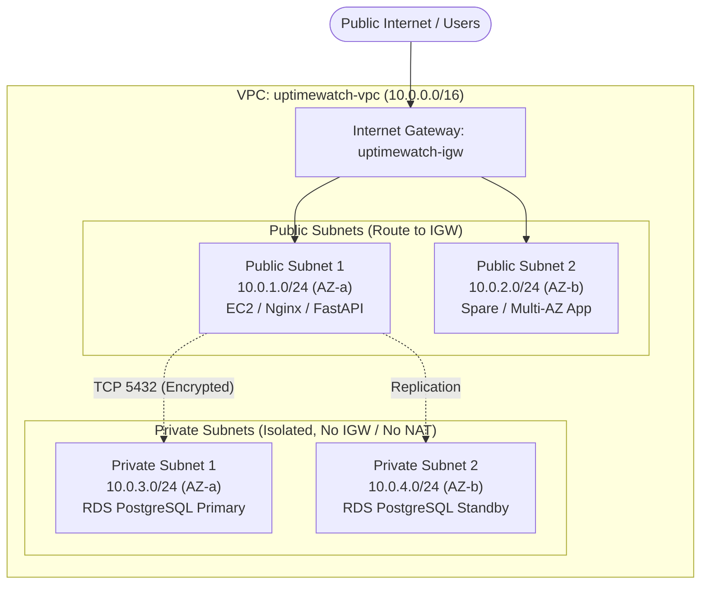

# UptimeWatch AWS Networking & VPC Architecture Guide

## 1. Executive Architecture Summary

The **UptimeWatch** cloud infrastructure is built inside a dedicated Amazon Virtual Private Cloud (VPC) designed under the AWS Well-Architected Framework:
- **Security by Segregation:** Public web-facing components (EC2 FastAPI worker & Nginx reverse proxy) are separated from the data persistence layer.
- **Zero-Trust Database Isolation:** Amazon RDS PostgreSQL resides in private, air-gapped subnets with **no route to the Internet Gateway and no NAT Gateway**, preventing any external vector of attack.
- **Least-Privilege Security Groups:** RDS accepts ingress exclusively from the EC2 security group ID on port 5432.

---

## 2. VPC & Subnet Allocation Topology



### Subnet Specifications

| Subnet Name | CIDR Block | Availability Zone | Route Table | Gateway Association | Intended Workload |
| :--- | :--- | :--- | :--- | :--- | :--- |
| `uptimewatch-public-1` | `10.0.1.0/24` | `us-east-1a` | `uptimewatch-public-rt` | Internet Gateway (`0.0.0.0/0`) | EC2 FastAPI, Nginx, Canaries |
| `uptimewatch-public-2` | `10.0.2.0/24` | `us-east-1b` | `uptimewatch-public-rt` | Internet Gateway (`0.0.0.0/0`) | Redundant App Tier / ALB |
| `uptimewatch-private-1` | `10.0.3.0/24` | `us-east-1a` | `uptimewatch-private-rt` | **None (Isolated)** | RDS PostgreSQL Primary Instance |
| `uptimewatch-private-2` | `10.0.4.0/24` | `us-east-1b` | `uptimewatch-private-rt` | **None (Isolated)** | RDS Multi-AZ Standby Instance |

---

## 3. Security Group Rules Matrix

### A. EC2 Application Tier (`uptimewatch-ec2-sg`)
Attached to: EC2 Instance (`UptimeWatch-FastAPI-Worker`)

| Direction | Type | Protocol | Port Range | Source / Destination | Purpose / Rationale |
| :--- | :--- | :--- | :--- | :--- | :--- |
| **Ingress** | SSH | TCP | `22` | `ADMIN_OFFICE_IP/32` | Bastion administrative access (Lock to admin IP) |
| **Ingress** | HTTP | TCP | `80` | `0.0.0.0/0` | Web HTTP traffic (Nginx redirect to HTTPS) |
| **Ingress** | HTTPS | TCP | `443` | `0.0.0.0/0` | Secure web application traffic & API calls |
| **Egress** | All Traffic | ALL | ALL | `0.0.0.0/0` | Outbound synthetic canary pings, SQS/SNS/S3 API calls |

### B. RDS Database Tier (`uptimewatch-rds-sg`)
Attached to: RDS PostgreSQL DB Subnet Group (`uptimewatch-db-subnet-group`)

| Direction | Type | Protocol | Port Range | Source / Destination | Purpose / Rationale |
| :--- | :--- | :--- | :--- | :--- | :--- |
| **Ingress** | PostgreSQL | TCP | `5432` | `uptimewatch-ec2-sg` (Security Group ID) | Allows queries **strictly** from EC2 worker instances |
| **Ingress** | All Others | ANY | ANY | `0.0.0.0/0` | **DENY ALL** - No public ingress allowed |
| **Egress** | PostgreSQL | TCP | `5432` | `uptimewatch-private-rt` | Local DB Subnet replication traffic only |

---

## 4. Route Table Definitions

### Public Route Table (`uptimewatch-public-rt`)
- `10.0.0.0/16` -> `local`
- `0.0.0.0/0` -> `uptimewatch-igw` (Target: Internet Gateway)
- Associated Subnets: `uptimewatch-public-1`, `uptimewatch-public-2`

### Private Route Table (`uptimewatch-private-rt`)
- `10.0.0.0/16` -> `local`
- Associated Subnets: `uptimewatch-private-1`, `uptimewatch-private-2`
- **Notice:** No default route `0.0.0.0/0` exists in this table, guaranteeing zero internet routability for the database.

---

## 5. Deployment Commands (AWS CLI Quickstart)

```bash
# 1. Create VPC
VPC_ID=$(aws ec2 create-vpc --cidr-block 10.0.0.0/16 --tag-specifications 'ResourceType=vpc,Tags=[{Key=Name,Value=uptimewatch-vpc}]' --query 'Vpc.VpcId' --output text)

# 2. Create Internet Gateway & Attach
IGW_ID=$(aws ec2 create-internet-gateway --tag-specifications 'ResourceType=internet-gateway,Tags=[{Key=Name,Value=uptimewatch-igw}]' --query 'InternetGateway.InternetGatewayId' --output text)
aws ec2 attach-internet-gateway --vpc-id $VPC_ID --internet-gateway-id $IGW_ID

# 3. Create Public Subnets
PUB1=$(aws ec2 create-subnet --vpc-id $VPC_ID --cidr-block 10.0.1.0/24 --availability-zone us-east-1a --query 'Subnet.SubnetId' --output text)
PUB2=$(aws ec2 create-subnet --vpc-id $VPC_ID --cidr-block 10.0.2.0/24 --availability-zone us-east-1b --query 'Subnet.SubnetId' --output text)

# 4. Create Private Subnets
PRIV1=$(aws ec2 create-subnet --vpc-id $VPC_ID --cidr-block 10.0.3.0/24 --availability-zone us-east-1a --query 'Subnet.SubnetId' --output text)
PRIV2=$(aws ec2 create-subnet --vpc-id $VPC_ID --cidr-block 10.0.4.0/24 --availability-zone us-east-1b --query 'Subnet.SubnetId' --output text)

# 5. Create RDS DB Subnet Group
aws rds create-db-subnet-group \
    --db-subnet-group-name uptimewatch-db-subnet-group \
    --db-subnet-group-description "Private isolated subnets for UptimeWatch PostgreSQL" \
    --subnet-ids $PRIV1 $PRIV2
```
